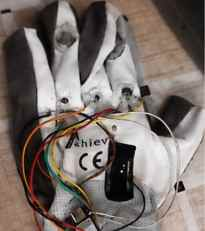

# EmpowerGlove Development Journal

## 2026-11-10 — BOM and pre-shipment documentation

### Cart review
Recorded the clearly visible parts from the Robocraze and Amazon cart screenshots in the root-level `BOM.csv`. The CSV preserves the displayed unit prices and quantities and labels all entries as planned/cart-listed rather than purchased or installed.

- Robocraze cart total shown: **₹17,373**
- Amazon cart subtotal shown: **₹903**
- Combined visible cart value: **₹18,276**
- The screenshots show a 15-item Robocraze cart; the visible line items reconcile to the displayed total. The Amazon screenshot shows three line items.

### Important architecture note
The current documented SmartGlove Pro prototype is based on a **Seeed XIAO ESP32-C3 and three Hall-effect sensors**. The **Raspberry Pi 5 4GB and 128GB microSD card are future upgrades only**, not part of the current prototype. The cart lists five SmartElex Hall sensor modules; confirm their compatibility and final quantity before purchase.

### CAD and PCB files
No custom enclosure CAD, mechanical assembly, or custom PCB has been designed for the documented prototype at this stage. The build uses a wearable glove, off-the-shelf development/sensor modules, and point-to-point wiring. Therefore, there is no genuine source CAD, PCB layout, Gerber set, or STEP assembly to publish yet. Do not create placeholder fabrication files that could be mistaken for manufacturing-ready designs.

If a custom enclosure, carrier PCB, or mounting bracket is designed later, add its editable source files and export a STEP model (where applicable) before shipment.

### Before shipment checklist
- [x] Confirm controller architecture: XIAO ESP32-C3 now; Raspberry Pi 5 is a future upgrade.
- [ ] Confirm the exact Hall sensor module and count; the current documented build uses three SS49E sensors.
- [ ] Confirm actual purchased quantities and update `BOM.csv` with final supplier/order details.
- [ ] Verify battery protection, charging, polarity, current draw, and safe mounting before wearable use.
- [ ] Add original prototype, wiring, and working-interface photographs.
- [ ] Add CAD/STEP and PCB source files only if custom mechanical/electronic designs are created.
- [ ] Test gesture recognition repeatedly and document results before claiming reliable operation.

## Procurement update

The root-level [BOM.csv](BOM.csv) now includes India-accessible supplier links, quantities, prices and a provisional total. The XIAO ESP32-C3 supplier page listed ₹739 during preparation; confirm the actual cart price before treating this as the final amount. The two Amazon entries use India search links so the exact listing can be selected and checked.

The original cart screenshots total ₹18,276 (Robocraze ₹17,373 + Amazon ₹903). Adding the XIAO board at the ₹739 supplier-page listing gives a provisional estimate of ₹19,015, excluding shipping and price changes.

## Photo evidence

The dated entry above includes an original photograph of the physical glove saved at `media/prototype/original-prototype.jpg`. Add a real photograph to each future dated journal entry. Do not substitute an AI-generated product render for evidence of the real working prototype.

## Notes
This journal records the project state and planned procurement based on the screenshots available on this date. Cart prices and availability may change; a cart is not proof of purchase.
