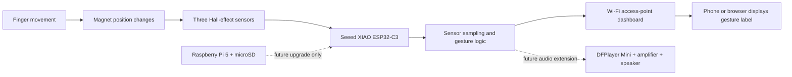

# 🧤 EmpowerGlove – Smart Glove

**An assistive wearable prototype exploring gesture-to-text communication.**

<p align="center">
  
  
  
  
</p>

EmpowerGlove is a student engineering project investigating an affordable wearable interface that senses selected finger movements and maps them to predefined communication labels. The current **SmartGlove Pro** iteration uses an **ESP32-C3** development board and **three SS49E linear Hall-effect sensors**.

> **Project status:** Experimental prototype. This repository documents development and testing; it is not a certified medical or accessibility device. It does not claim to translate complete sign languages.

## At a glance

| Area | Current documented build |
|---|---|
| Controller | ESP32-C3 (XIAO ESP32-C3 form factor) |
| Sensors | 3 × SS49E linear Hall-effect sensors |
| Sensor positions | Index, middle and ring fingers |
| Current interface direction | ESP32-C3 Wi-Fi access-point dashboard |
| Output direction | Recognized gesture text; speech is a future/optional extension |
| Firmware status | Sensor-reading starter sketch; pin mapping and calibration required |

## How it works

1. A finger moves a magnet relative to its Hall-effect sensor.
2. The sensor produces an analog voltage that changes with the magnetic field.
3. The ESP32-C3 samples the sensor outputs.
4. Calibrated readings are filtered and compared with defined gesture patterns.
5. A recognized label can be shown through a local interface; audio output can be explored separately.

The magnet arrangement, board pinout, ADC range and thresholds must be verified on the actual assembled glove.

## Repository structure

```text
EmpowerGlove/
├── .github/                  # Issue templates
├── docs/                     # Project, hardware, wiring and test documentation
├── firmware/esp32-c3/        # ESP32-C3 Arduino firmware
├── gestures/                 # Gesture vocabulary and sample-data template
├── hardware/                 # Circuit and wearable design files
├── media/                    # Project, prototype and circuit photos
├── web-interface/            # Web dashboard documentation and source
├── CHANGELOG.md
├── CITATION.cff
├── CONTRIBUTING.md
├── LICENSE
├── README.md
└── SECURITY.md
```

## Getting started

1. Read [Project overview](docs/project-overview.md).
2. Check [Hardware and components](docs/hardware-and-components.md) and [Wiring notes](docs/wiring.md).
3. Install Arduino IDE and the ESP32 board package for your exact ESP32-C3 board.
4. Open [`firmware/esp32-c3/src/main.ino`](firmware/esp32-c3/src/main.ino).
5. Set the verified ADC GPIO numbers for your board. The starter sketch intentionally uses placeholders.
6. Test each sensor individually, then record readings in [Testing and calibration](docs/testing-and-calibration.md).

**Do not upload the starter sketch expecting gesture recognition immediately.** It currently reads three analog channels and prints raw values only. Gesture classification and the web server need to be integrated and tested in the next firmware iteration.

## Documentation

- [Project overview](docs/project-overview.md)
- [Working principle](docs/working-principle.md)
- [Hardware and components](docs/hardware-and-components.md)
- [Wiring notes](docs/wiring.md)
- [Testing and calibration](docs/testing-and-calibration.md)
- [Gesture vocabulary](docs/gesture-vocabulary.md)
- [Development roadmap](docs/roadmap.md)
- [Web interface notes](web-interface/README.md)

## Bill of materials and procurement

The table below is the human-readable BOM; the complete machine-readable list is [BOM.csv](BOM.csv). Prices are transcribed from the supplied cart screenshots or a provisional supplier-page estimate. Links open Indian supplier/product pages or India-specific search results. Verify exact listing, stock and checkout price before ordering.

| Part | Qty. | Unit price | Line total | Source |
|---|---:|---:|---:|---|
| Seeed XIAO ESP32-C3 (current controller) | 1 | ₹739* | ₹739* | [Robocraze](https://robocraze.com/products/seeed-studio-xiao-esp32c3) |
| Raspberry Pi 5 4GB (future upgrade) | 1 | ₹13,409 | ₹13,409 | [Robocraze](https://robocraze.com/products/raspberry-pi-5-4gb) |
| SanDisk 128GB microSDXC (future upgrade) | 1 | ₹2,809 | ₹2,809 | [Robocraze](https://robocraze.com/products/sandisk-128-gb-microsdxc-memory-card) |
| Mini DF MP3 Player Module MP3-TF-16P | 1 | ₹94 | ₹94 | [Robocraze](https://robocraze.com/products/dfplayer-mini-mp3-module) |
| Hook-up wire packet (five colours) | 5 | ₹75 | ₹375 | [Robocraze](https://robocraze.com/products/single-stranded-hook-up-wires-1m-each-5-colors) |
| SmartElex Hall sensor module | 5 | ₹122 | ₹610 | [Robocraze](https://robocraze.com/products/smartelex-hall-sensor) |
| 8Ω speaker (cart listing) | 1 | ₹54 | ₹54 | [Robocraze](https://robocraze.com/products/8-ohm-0-25w-speaker) |
| PAM8403 amplifier module | 1 | ₹22 | ₹22 | [Robocraze](https://robocraze.com/products/pam8403-digital-power-amplifier) |
| 10 × 2mm neodymium disc magnets (30 pcs) | 1 | ₹399 | ₹399 | [Amazon India search](https://www.amazon.in/s?k=10x2mm+neodymium+disc+magnets) |
| Grey-white nitrile-coated work gloves (10 pairs) | 1 | ₹349 | ₹349 | [Amazon India search](https://www.amazon.in/s?k=grey+white+nitrile+coated+work+gloves+pack+of+10) |
| 3.7V 500mAh LiPo battery | 1 | ₹155 | ₹155 | [Amazon India search](https://www.amazon.in/s?k=3.7V+500mAh+LiPo+battery) |
| **Estimated total** | | | **₹19,015** | |

*The XIAO ESP32-C3 price is a provisional ₹739 supplier-page estimate and was not visible in the original cart screenshots. The other values are transcribed from the supplied screenshots. The original carts total ₹18,276 (Robocraze ₹17,373 + Amazon ₹903); adding the estimated XIAO price gives ₹19,015. Shipping and price changes are excluded.

**Current prototype:** XIAO ESP32-C3 with three Hall sensors. **Future upgrade:** Raspberry Pi 5 and microSD card. The five SmartElex modules shown in the cart are planned purchases; confirm compatibility and final quantity against the current three-sensor design before ordering. The BOM lists planned/cart-listed items, not proof of purchase or installation.

[Open the complete BOM CSV](BOM.csv) · [Development journal](JOURNAL.md)

## Prototype photograph

This is an original photograph of the physical glove prototype (not a concept render):


## System overview



The diagram is a system-level overview, not a pin-accurate electrical schematic. The actual GPIO mapping remains to be verified and recorded in [Wiring notes](docs/wiring.md). The current prototype is hand-wired and has no custom PCB, so PCB layout/Gerber screenshots are not applicable yet. A custom mechanical CAD/STEP assembly is also not available because the current build uses a fabric glove and off-the-shelf modules without a designed enclosure.

## Photos and demonstrations

Add original photographs to `media/project/`, prototype close-ups to `media/prototype/`, and wiring images to `media/circuit/`. Use relative image paths so the images work for people who clone the repository.

Only publish media you own or have permission to share. Get consent before posting identifiable people, and remove private details such as passwords, school IDs and phone numbers.

## Safety and limitations

- Three sensors can represent only a limited set of measured finger configurations.
- This prototype is not a complete sign-language translator.
- Recognition performance must be measured across repeated trials and different glove fits.
- Verify all electrical limits, board pin mappings and battery protection before powering wearable hardware.
- Do not rely on this experimental prototype as the only means of communication in an emergency.

## Contributing

Suggestions and improvements are welcome. Read [CONTRIBUTING.md](CONTRIBUTING.md) and use the GitHub issue templates to report bugs or propose features.

## License and citation

The project is released under the [MIT License](LICENSE). If you use or reference this project, see [CITATION.cff](CITATION.cff).

---
**EmpowerGlove — exploring technology for more inclusive communication.**
