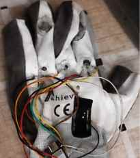
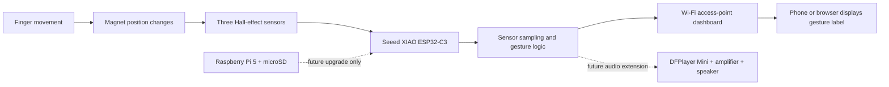

# 🧤 EmpowerGlove – Smart Glove

**An assistive wearable prototype exploring gesture-to-text communication.**

<p align="center">
  
  
  
  
</p>

EmpowerGlove is a student engineering project investigating an affordable wearable interface that senses selected finger movements and maps them to predefined communication labels. The current **SmartGlove Pro** iteration uses an **ESP32-C3** development board and **three SS49E linear Hall-effect sensors**.

> **Project status:** Experimental prototype. This repository documents development and testing; it is not a certified medical or accessibility device. It does not claim to translate complete sign languages.

## At a glance

| Area | Current documented build |
|---|---|
| Controller | ESP32-C3 (XIAO ESP32-C3 form factor) |
| Sensors | 3 × SS49E linear Hall-effect sensors |
| Sensor positions | Index, middle and ring fingers |
| Current interface direction | ESP32-C3 Wi-Fi access-point dashboard |
| Output direction | Recognized gesture text; speech is a future/optional extension |
| Firmware status | Sensor-reading starter sketch; pin mapping and calibration required |

## How it works

1. A finger moves a magnet relative to its Hall-effect sensor.
2. The sensor produces an analog voltage that changes with the magnetic field.
3. The ESP32-C3 samples the sensor outputs.
4. Calibrated readings are filtered and compared with defined gesture patterns.
5. A recognized label can be shown through a local interface; audio output can be explored separately.

The magnet arrangement, board pinout, ADC range and thresholds must be verified on the actual assembled glove.

## Repository structure

```text
EmpowerGlove/
├── .github/                  # Issue templates
├── docs/                     # Project, hardware, wiring and test documentation
├── firmware/esp32-c3/        # ESP32-C3 Arduino firmware
├── gestures/                 # Gesture vocabulary and sample-data template
├── hardware/                 # Circuit and wearable design files
├── media/                    # Project, prototype and circuit photos
├── web-interface/            # Web dashboard documentation and source
├── CHANGELOG.md
├── CITATION.cff
├── CONTRIBUTING.md
├── LICENSE
├── README.md
└── SECURITY.md
```

## Getting started

1. Read [Project overview](docs/project-overview.md).
2. Check [Hardware and components](docs/hardware-and-components.md) and [Wiring notes](docs/wiring.md).
3. Install Arduino IDE and the ESP32 board package for your exact ESP32-C3 board.
4. Open [`firmware/esp32-c3/src/main.ino`](firmware/esp32-c3/src/main.ino).
5. Set the verified ADC GPIO numbers for your board. The starter sketch intentionally uses placeholders.
6. Test each sensor individually, then record readings in [Testing and calibration](docs/testing-and-calibration.md).

**Do not upload the starter sketch expecting gesture recognition immediately.** It currently reads three analog channels and prints raw values only. Gesture classification and the web server need to be integrated and tested in the next firmware iteration.

## Documentation

- [Project overview](docs/project-overview.md)
- [Working principle](docs/working-principle.md)
- [Hardware and components](docs/hardware-and-components.md)
- [Wiring notes](docs/wiring.md)
- [Testing and calibration](docs/testing-and-calibration.md)
- [Gesture vocabulary](docs/gesture-vocabulary.md)
- [Development roadmap](docs/roadmap.md)
- [Web interface notes](web-interface/README.md)

## Bill of materials and build journal

- [BOM.csv](BOM.csv) — visible cart-listed components, quantities and displayed prices. Items are marked as planned; a shopping cart is not proof of purchase.
- [JOURNAL.md](JOURNAL.md) — development notes, architecture caveats and the pre-shipment checklist.

**Procurement note:** The current documented prototype uses an ESP32-C3 with three SS49E Hall sensors. The cart also lists a Raspberry Pi 5, microSD card and five SmartElex Hall sensor modules; these are recorded as planned items and are not represented as already integrated. Review the journal before purchasing or assembling.

**CAD/PCB note:** No custom enclosure or PCB has been designed for the current point-to-point prototype, so no STEP or fabrication source files are available yet. This is documented in `JOURNAL.md`; add editable CAD/PCB sources and STEP exports if custom designs are created later.

## Bill of materials and procurement

The detailed, machine-readable list is in [BOM.csv](BOM.csv). It includes a supplier/product link for each line, quantity, displayed or estimated unit price, and line total.

**Current planned controller:** Seeed XIAO ESP32-C3 (₹739 supplier-page listing used as a provisional estimate; confirm the cart/checkout price).

**Future upgrade only:** Raspberry Pi 5 4GB and 128GB microSD card. They are not part of the current ESP32-C3 prototype.

**Budget snapshot:** ₹18,276 from the supplied cart screenshots, plus ₹739 provisional XIAO ESP32-C3 listing = **₹19,015 estimated component total**. Shipping, taxes if not included, and price changes may alter the final checkout amount. Amazon links in the BOM are search links where an exact stable product URL was not available.

## Prototype photograph

This is an original photograph of the physical glove prototype (not a concept render):



## System overview



The diagram is a system-level overview, not a pin-accurate electrical schematic. The actual GPIO mapping remains to be verified and recorded in [Wiring notes](docs/wiring.md). The current prototype is hand-wired and has no custom PCB, so PCB layout/Gerber screenshots are not applicable yet. A custom mechanical CAD/STEP assembly is also not available because the current build uses a fabric glove and off-the-shelf modules without a designed enclosure.

## Photos and demonstrations

Add original photographs to `media/project/`, prototype close-ups to `media/prototype/`, and wiring images to `media/circuit/`. Use relative image paths so the images work for people who clone the repository.

Only publish media you own or have permission to share. Get consent before posting identifiable people, and remove private details such as passwords, school IDs and phone numbers.

## Safety and limitations

- Three sensors can represent only a limited set of measured finger configurations.
- This prototype is not a complete sign-language translator.
- Recognition performance must be measured across repeated trials and different glove fits.
- Verify all electrical limits, board pin mappings and battery protection before powering wearable hardware.
- Do not rely on this experimental prototype as the only means of communication in an emergency.

## Contributing

Suggestions and improvements are welcome. Read [CONTRIBUTING.md](CONTRIBUTING.md) and use the GitHub issue templates to report bugs or propose features.

## License and citation

The project is released under the [MIT License](LICENSE). If you use or reference this project, see [CITATION.cff](CITATION.cff).

---
**EmpowerGlove — exploring technology for more inclusive communication.**
