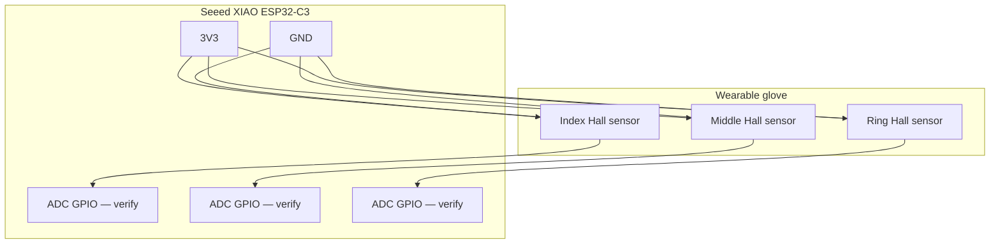

# Wiring Notes

The exact GPIO assignment is intentionally left open until the final board revision and physical wiring are confirmed.

| Signal | ESP32-C3 connection | Notes |
|---|---|---|
| Hall sensor 1 output | `PIN_HALL_INDEX` placeholder | Analog-capable pin only |
| Hall sensor 2 output | `PIN_HALL_MIDDLE` placeholder | Analog-capable pin only |
| Hall sensor 3 output | `PIN_HALL_RING` placeholder | Analog-capable pin only |
| Sensor VCC | According to sensor and board specifications | Check supply voltage compatibility |
| Sensor GND | GND | Common ground required |

## Wiring checklist
- Identify the exact ESP32-C3 board revision and its pinout.
- Check the SS49E datasheet and the breakout-board pin labels, if using modules.
- Verify sensor supply and output voltage are safe for the ESP32-C3 ADC.
- Confirm all grounds are connected.
- Test one sensor at a time before connecting all three.
- Record the actual GPIO mapping in this file and in the firmware comments.

**Never guess pin numbers.** The XIAO ESP32-C3 does not expose every ESP32-C3 GPIO as a labelled analog pin, and ADC availability depends on the board and pin mapping.

## Conceptual wiring diagram (verify before assembly)

This diagram shows the signal and power relationships only. It deliberately uses GPIO placeholders because the final XIAO ESP32-C3 pin mapping must be confirmed against the exact board revision and firmware.

| Sensor connection | Board connection |
|---|---|
| VCC (each sensor) | 3V3, only if supported by the exact sensor/module |
| GND (each sensor) | GND (common ground) |
| Index analog output | Verified ADC-capable GPIO |
| Middle analog output | Verified ADC-capable GPIO |
| Ring analog output | Verified ADC-capable GPIO |

Do not copy placeholder GPIO labels into firmware. Measure the output voltage and confirm it never exceeds the XIAO ESP32-C3 ADC input limits. The optional DFPlayer/amplifier/speaker chain is a planned audio extension, not shown as currently wired.

